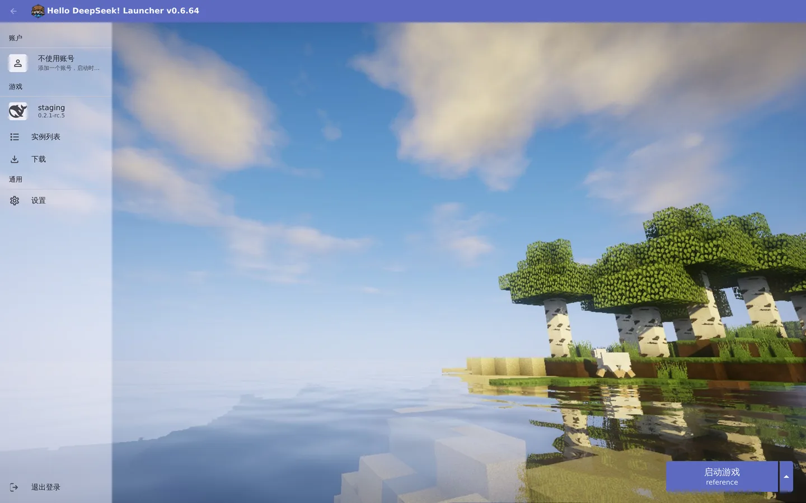
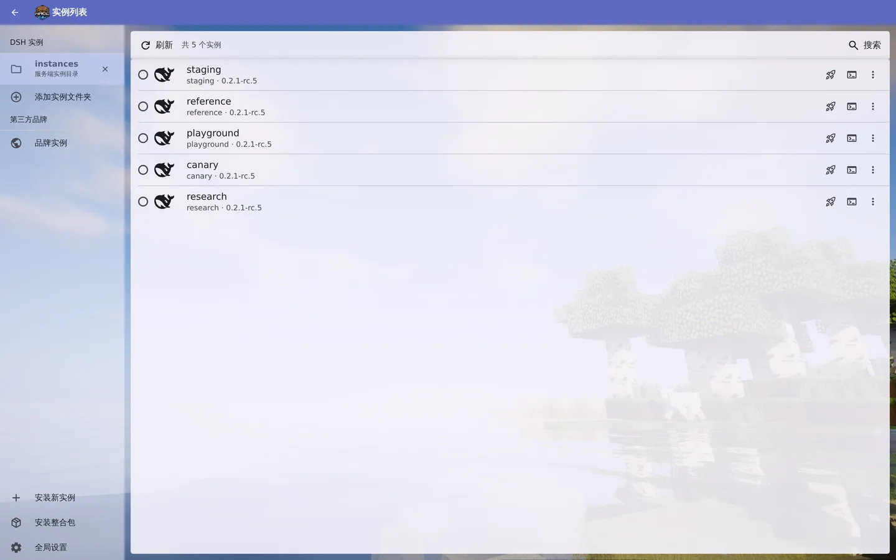
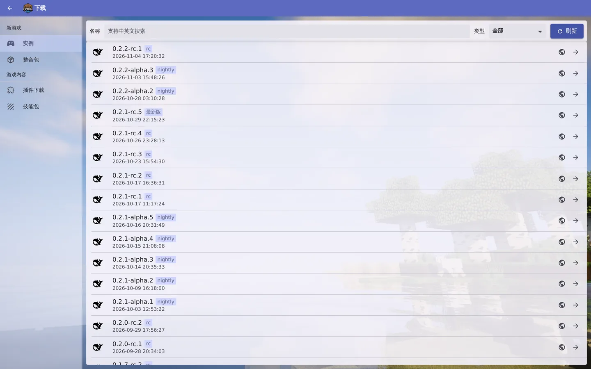
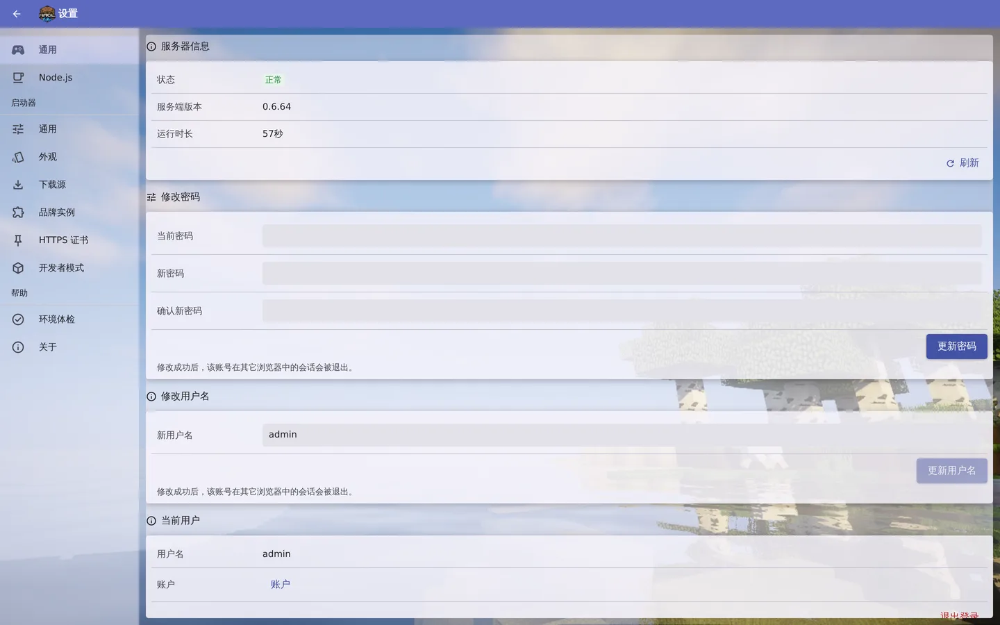
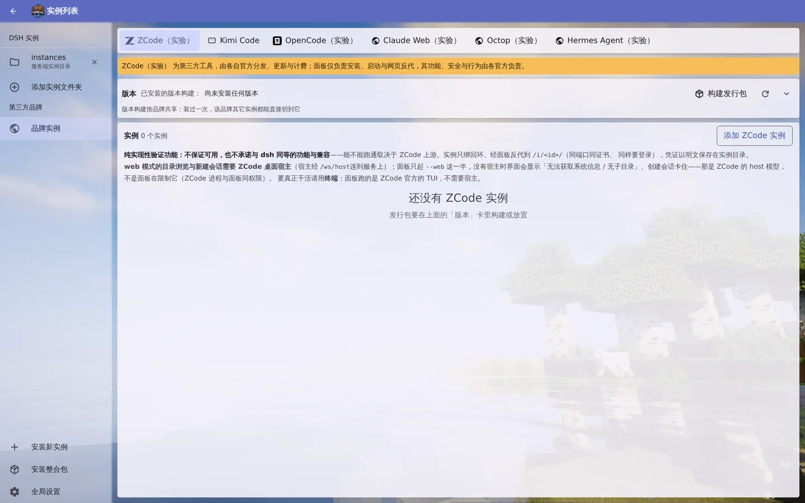
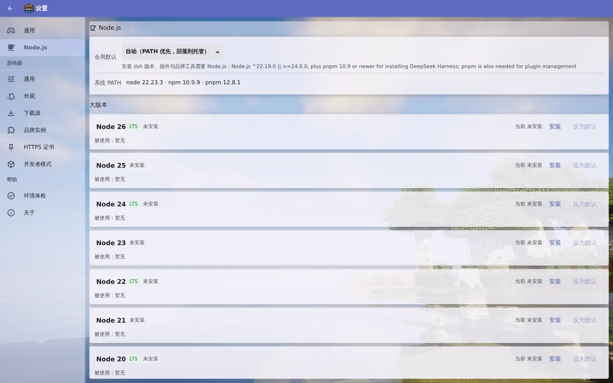
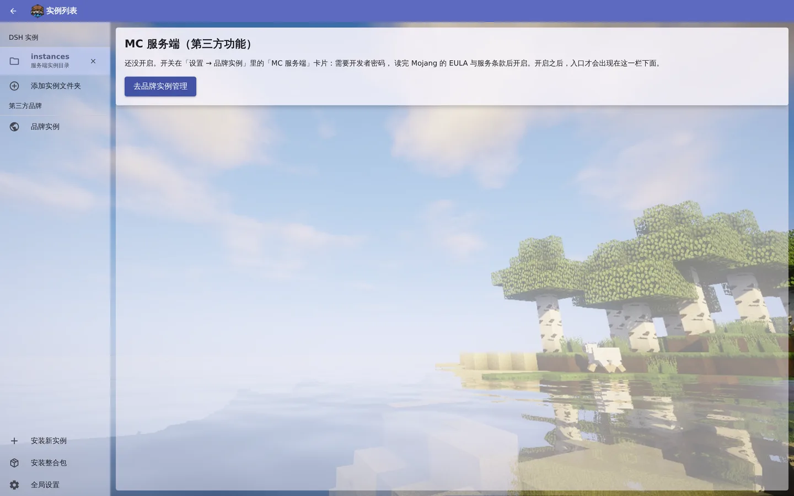
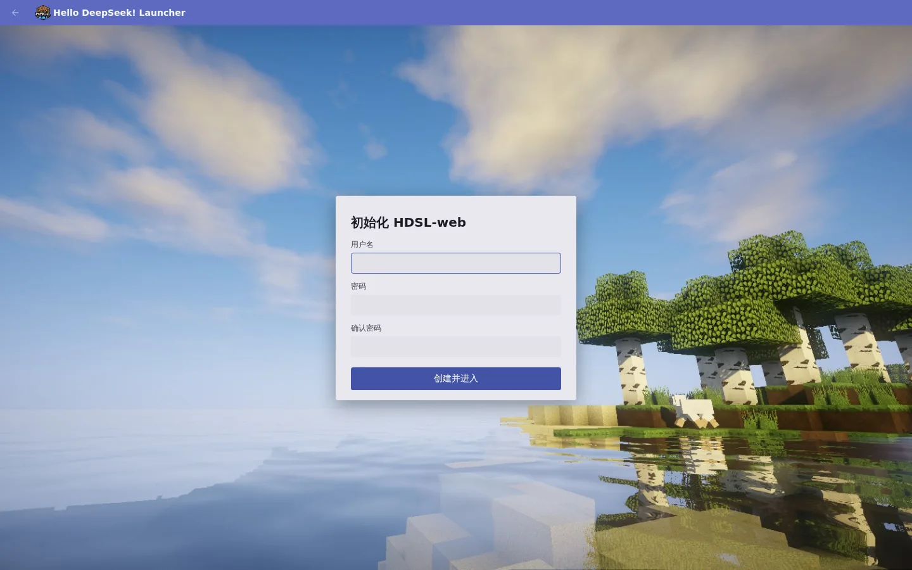

# HDSL-web

[](https://github.com/nas200-timmy/HDSL-WEB/actions/workflows/build.yml)
[](https://github.com/nas200-timmy/HDSL-WEB/actions/workflows/docker.yml)
[](https://github.com/nas200-timmy/HDSL-WEB/releases)
[](https://github.com/nas200-timmy/HDSL-WEB/pkgs/container/hdsl-web)
[](LICENSE)
[]()

把 [HDSL](https://github.com/MCXCC303/HDSL)（Hello DeepSeek! Launcher，桌面版）搬进浏览器的单容器版本。

打开网页 → 登录 → 建实例 → 点「启动」，在同一个域名、端口与证书下用 agent 自己的界面。除 dsh 外，
Kimi Code、OpenCode、Claude Web、Octop、Hermes、PI WEB、Qwen Code、MiMo Code、MiniMax Code、ZCode
也能一起装；能开终端的实例都配一个**原地终端**。
转码是同一容器里的另一件一等功能：默认关闭，开启后在面板里批量编码、硬件加速与 GPU 监控。
面板还自带**聊天页**：多助手、流式输出、附件与联网搜索，账户与 key 直接复用面板里已有的。

界面按桌面版复刻（HMCL 视觉语言、Material You 主题、同款图标与动画）：实例、版本、插件、账户、
整合包、会话、技能、体检与 ACP 控制台都在。



## 目录

- [亮点](#亮点)
- [截图](#截图)
- [功能速览](#功能速览)
- [架构](#架构)
- [实例终端（Web Shell）](#实例终端web-shell)
- [快速开始](#快速开始) — Release / Docker Compose / 裸 `java -jar`
- [首次登录与初始化引导](#首次登录与初始化引导)
- [数据与挂载点](#数据与挂载点)
- [声明式 HTTPS](#声明式-https)
- [环境变量](#环境变量)
- [反向代理](#反向代理)
- [安全说明](#安全说明)
- [构建与开发](#构建与开发)
- [常见问题](#常见问题)
- [设计说明](docs/design-notes.md)
- [转码模块（批量编码、硬件加速、GPU 监控）](docs/transcode.md)
- [面板聊天（多助手、流式、附件、联网搜索）](docs/chat.md)
- [许可](#许可)

## 亮点

### 十一种 Agent，一个面板，想换就换

| Agent | 网页入口 | 原地终端（Web Shell） |
|---|---|---|
| DeepSeek Harness（`dsh`） | dsh 自己的网页 | `dsh tui [--resume]` |
| Kimi Code | `kimi web` | 官方 TUI |
| OpenCode | `opencode web` | 官方 TUI |
| Claude Web（社区工作台） | 它自己的网页 | Claude Code CLI —— 社区引擎 / 官方二进制，**进之前自己选** |
| Octop（自托管助手） | 它自己的网页 | 无（网页控制台） |
| Hermes Agent（实验） | 它自己的网页 | 官方 TUI `hermes --tui`（与网页模式互斥） |
| PI WEB（实验） | 它自己的网页，或纯终端实例 | 官方 TUI（终端为主） |
| Qwen Code（TUI 品牌） | 无（纯终端） | 官方 TUI `qwen` |
| MiMo Code（TUI 品牌） | 无（纯终端） | 官方 TUI（原生二进制 / Node 启动器） |
| MiniMax Code（TUI 品牌） | 无（纯终端） | 官方 TUI `mcode` |
| ZCode（实验性品类） | `zcode --web` | 官方 TUI（发行包不带参数就是它） |

同一个品牌的版本装一次、所有实例共用；点一下就在实例之间切换，不用重装、不用换端口、不用记第二套地址。dsh 这边还完整搬来了桌面版的账户、插件、整合包、会话、技能、体检与 ACP 控制台。Qwen / MiMo / MiniMax 是**纯终端品牌**：实例就是一个 PTY，没有网页进程、端口与 `/i/<id>/` 挂载，启动/停止/打开网页会被明确拒绝。

### 同一个实例，网页和终端都行

「打开」进它的网页模式；「终端」进同一个实例的原生 TUI——同一份 `home`、同一批会话记录：那边开始的工作，这边接着做，不用重新登录、不用重新配账号。终端不是另开一个 shell，而是把 agent 自己的交互界面嵌进页面：关窗/刷新只算 detach，agent 继续跑，回来时把最近 256 KB 输出回放给你。顺序也顺手了——先过开发者密码（30 分钟滑动），Claude Web 再选一下内核，然后才出现终端窗口。

### 一个容器、一个端口，隔离做到实例级

- **一个 JVM、一个端口**（默认 3080）：面板、REST、WebSocket、每个实例的反代全在同一个端口后面，同一张证书；外面再套 nginx/Caddy 也好配。
- **每个实例一份自己的 `home` 与工作区**：dsh 是独立的 `DSH_HOME`，品牌实例把 `HOME`/`USERPROFILE` 指到实例目录——换实例就是换一套账号、配置和会话，彼此不串。
- **实例自己的端口只在回环上**：dsh 实例在 3081–4081 里分配、终身绑定，品牌实例从 20000–60999 里挑一个；对外只有面板这一道门。agent 的凭据落在数据卷里的实例目录，不散在宿主。
- **终端是一张一次性 ticket**（30 秒、绑定实例与会话）：关掉网页不影响 agent，面板退出才一起收掉。
- **两层钥匙**：面板密码 + 开发者密码第二因子；Web Shell 只在 HTTPS 下开，也能整体关掉。
- **备份只有一个目录**：配置、证书、账号、实例、`DSH_HOME`、pnpm store 全在 `/data` 下，拷走那一个卷就搬完了（工作区可以另挂宿主机目录）。

## 截图

| | |
|---|---|
|  |  |
| 主界面与启动面板 | 实例列表（DSH / 品牌两层） |
|  |  |
| 下载（真实 npm 版本列表） | 设置（通用） |
|  |  |
| 品牌实例（6 个品牌，原地切换） | Node.js 运行时（18–26 按大版本） |
|  |  |
| Minecraft 服务端（默认关闭） | 首启初始化（建管理员账号） |

> 截图来自一份演示数据集：5 个停止态的 dsh 实例，没有真实账号、供应商、路径或口令。
> 重新生成的做法见 [docs/screenshots/README.md](docs/screenshots/README.md)。

## 功能速览

| 项目 | 说明 |
|---|---|
| 交付 | 一个可执行 fat jar（`java -jar hdsl-web.jar`）和一个 Debian 容器镜像 |
| 运行前提 | JDK 17+；Node `^22.19.0 || >=24.0.0` 与 pnpm（dsh 由 pnpm 安装、由 node 运行）。FreeBSD 用 `pkg install node npm` 的系统 Node（没有托管构建），交互式终端已支持，但 **dsh 实例不可用**（上游 native addon 与 flock 两层拒绝），系统指标页大部分为空；设置 → 通用 → 平台兼容性会列出当前平台的已知差异，见 [docs/deployment.md §12](docs/deployment.md) |
| 手机 | 窄屏（≤760px）或矮屏（≤520px）自动切换移动版式：主导航收成抽屉、子侧栏变顶部标签条、启动面板变成贴底操作栏；可点区域 44px；支持「加到主屏幕」。见 [docs/ui-spec.md §14](docs/ui-spec.md) |
| 账户 | 为供应商填一次 API Key；供应商与模型来自 [models.dev](https://models.dev)（200+ 家，选中即带出端点、协议与密钥变量），也可手输；目录不可达时退回内置供应商与手输。见 [docs/ui-spec.md §4](docs/ui-spec.md) |
| 聊天 | 面板内的多助手聊天页：流式输出、停止、两种重新生成、跨服务模型选择、按轮思考/搜索时间线（普通协议与流式也走）、右侧附件预览栏（图片/音视频/PDF 原生渲染，文本分页，CSV 表格）、图片/PDF/Office 附件与长文本转附件、按助手隔离系统提示词；会话存 SQLite，可每日备份。可选联网搜索（博查 / DeepSeek / 智谱 / Tavily / Brave / Exa），输入区可按消息选搜索源，模型只会拿到只读的 `search_web` / `scrape_web`，不能触发面板操作。独立 `/chat/settings` 收成 5 组：个人资料 / 模型 / 联网搜索 / 数据与备份 / 安全与网络。内置可开关的「DeepSeek 官方」预设角色：固定 DeepSeek 官方协议，使用官方联网搜索、读链接、来源引用、按块思考/搜索时间线与自动标题，不读面板搜索 provider；默认助手兼容 DeepSeek 的 DSML 文本工具调用。见 [docs/chat.md](docs/chat.md) |
| 纯文本版 | 无 JavaScript 的 `/plain`：登录、会话列表、历史、发送、附件下载，提交后刷新看结果；w3m / lynx / 旧浏览器可用。现代界面在入口检测 fetch / WebSocket / flex，缺任何一项就跳到「浏览器太旧」提醒页，可一键进入纯文本版。见 [docs/plain-surface.md](docs/plain-surface.md) |
| 创建实例 | 创建即安装；未安装的实例点「启动」会先装再启；进度与失败原因都在面板上。见 [docs/launcher-orchestration.md](docs/launcher-orchestration.md) |
| 品牌实例 | 安装、版本共享与实验性边界见 [docs/brands.md](docs/brands.md)；Octop 见 [docs/octop.md](docs/octop.md)；ZCode 见 [docs/zcode-experimental.md](docs/zcode-experimental.md)（版本目录、按实例的最低版本/凭据格式闸门、3.18.x credential-secret 与密钥轮换）。Qwen / MiMo / MiniMax 是纯终端品牌（无网页进程、端口与 `/i/` 挂载） |
| Minecraft | 默认关闭的第三方功能；开关在「设置 → 品牌实例」，需开发者密码并阅读 Mojang EULA 与服务条款。存档在 `/home/hdsl/mc`，容器部署必须挂出来。见 [docs/minecraft.md](docs/minecraft.md) |
| 转码 | 默认关闭的第三方功能；开关同样在「设置 → 品牌实例」，需开发者密码并阅读须知。服务端队列批量编码，硬件失败按 QSV → VAAPI → CPU 每次降一档（或完全自动化），参数面板对齐 3FUI。媒体根是 `/home/hdsl/video`，ffmpeg 支持静态包 / apt-dnf / 源码编译三种装法。见 [docs/transcode.md](docs/transcode.md) |
| 下载源 | 设置页可选预设镜像（npmmirror / 中科大 / 腾讯云 / 华为云 / 官方）或手填 URL；保存即生效。见 [docs/deployment.md](docs/deployment.md) |
| 安全 | 威胁模型、误配自查与免责统一在 [docs/security.md](docs/security.md) |
| 从零重建 | [docs/build-from-scratch-prompt.md](docs/build-from-scratch-prompt.md) 是一份完整任务提示词，**只在新仓库用** |

## 架构

```
浏览器标签页 A：HDSL 面板            浏览器标签页 B：dsh web
   https://host:3080（同一张证书、同一端口）
        │                                   │
        ▼                                   ▼
┌─ 单个容器（HDSL-web）────────────────────────────────────────┐
│  Jetty 边缘（一个 JVM 进程，监听 0.0.0.0:3080）               │
│   ├─ SPA 静态资源（React 构建产物，已打进 jar）               │
│   ├─ /api/*       REST（认证/实例/版本/插件/账户/整合包/…）   │
│   ├─ /ws          WebSocket（日志流、任务进度、状态事件）      │
│   ├─ /ws/terminal WebSocket（原地终端：实例原生 TUI）          │
│   └─ /i/{id}/*    反向代理 → 127.0.0.1:3081-4081             │
│  Java 领域层（自 HDSL 移植）：实例、版本、插件、账户、整合包   │
│  dsh 实例进程池：node bin.js --profile web --port N …        │
│  伪终端：kimi / opencode / dsh（dsh 需先装 TUI 插件）        │
│  容器内置 JDK 21 + Node 22 + pnpm + 构建工具链(go/rust/gcc)   │
└───────────────────────────────────────────────────────────────┘
        │  卷：hdsl-data → /data（唯一需要持久化的目录）
        ▼
```

面板与 dsh 是两个彼此独立的页面：面板负责启动和停止，使用在 dsh 自己的页面里。Kimi Code、
OpenCode、Claude Web 与 ZCode 同理——各有自己的网页进程，用同一个 `/i/<id>/` 挂载点代理，
终端也都走同一个 `TerminalManager`（见 [docs/brands.md](docs/brands.md)、
[docs/zcode-experimental.md](docs/zcode-experimental.md)）。前面再放一层 nginx/Caddy 也支持，
`Host` 必须原样透传。细节见 [docs/deployment.md](docs/deployment.md) 与
[docs/design-notes.md](docs/design-notes.md)。

> 架构图见 [docs/architecture/](docs/architecture/README.md)：`context.md` 是系统上下文，
> `full.md` 是全量模块与数据布局，`flows/` 是 MC 安装、品牌启动、认证三条关键时序。

## 实例终端（Web Shell）

实例行上的「终端」按钮就地打开该实例的原生 TUI：Kimi Code、OpenCode、ZCode（实验性
品类，`node <发行包>/bin/zcode.mjs`，不带 `--web` 就是官方 TUI）、Claude Web（它的内核
就是 Claude Code CLI，见下），以及 dsh 的 `dsh tui [--resume]`。终端跑在面板进程里、
走现有 WebSocket——**不新增端口，也不需要反向代理**。这是面板里唯一的终端入口。

Claude Web 有两个内核可以选：**社区引擎**（`claude-web-engine`，网页里配置的第三方/中转
供应商只对它生效）和**官方 Claude Code**（只认 Anthropic 账号）。点终端时先过开发者密码，
再让你选内核，然后才进终端；只装了一个内核时不会多问这一步。选了没装的那个会明确报错，
不会偷偷换成另一个。

两者最终都连 Anthropic：面板在**不受支持地区**（含中国大陆）访问 `api.anthropic.com` 会被
直接拒绝（403）。所以 Claude Web 实例的菜单里有一个**「Anthropic 端点…」**，可以给这个实例填
`ANTHROPIC_BASE_URL`（网页模式与终端共用；留空即恢复默认），选官方内核时面板还会先探一次端点，
把 403 变成一句人话而不是一个起不来的终端。细节与合规提示见
[docs/brands.md §Claude Web：官方内核与 ANTHROPIC_BASE_URL](docs/brands.md)。

和「打开」按钮的区别：打开是在新标签页用该实例的网页模式；终端是在当前页面覆盖一层真终端，
直接操作 agent 自己的交互界面。

### 打开前需要什么

| 前提 | 说明 |
|---|---|
| **HTTPS** | 面板此刻必须真的在讲 TLS，或者你打开了 `https.trust_forwarded_proto` 并由反代终结 TLS。HTTP 下终端按钮不显示，接口返回 403 `insecure_transport` |
| **开发者密码** | 独立的第二因子，和面板密码分开。在「设置 → 开发者模式」里设置（需要面板密码确认），打开终端时验证一次 |
| **Web Shell 开关** | 默认开启。设置 →「开发者模式」里可以整体关闭，见下文 |
| **实例已就绪** | dsh 实例要先装好 dsh；品牌实例要先装好对应版本 |

第一次点「终端」时如果还没设过开发者密码，会先弹设置表单（面板密码 + 新密码 + 确认，
至少 8 位、不能与面板密码相同）；之后每次打开先弹一次密码框，验证通过才换成终端窗口——
不会先给你一个空终端再在里面要密码。验证状态 **30 分钟滑动有效**，期间重复打开不用再输。

### 用起来是什么样

- **以实例为单位**：终端用的是该实例自己的 home、账号与模型路由。TUI 里能 resume 的会话，
  和网页模式看到的是同一份数据；不会出现「换了个终端就找不到会话」。
- **会话常驻**：关窗、刷新页面、切走只算 detach，agent 继续跑；再点「终端」接回同一个会话，
  并回放最近 256 KB 输出。
- **同一实例单会话**：一个实例同时只允许一个终端；第二个窗口返回 409 `terminal_already_open`，
  请先在已打开的窗口里操作或停止它。
- **打开终端会先停网页模式**：两者共用同一个 `DSH_HOME`，同时跑会互相抢 agent 的状态。想回到
  网页模式，关掉终端后点实例行上的「启动」即可。
- **什么时候才真的结束**：在 TUI 里 `/exit`、点底栏「停止」、停止或删除品牌实例，或者面板
  进程退出。其中 agent 自己退出后，窗口还会显示退出码；关掉窗口不会留下任何可交互的 shell。
- **不是通用 shell**：PTY 里运行的只有该品牌的 TUI 进程，没有登录 shell、没有自由命令、文件
  上传下载或端口转发。agent 退出后会话即被移除，attach 会返回 410。

### 安全前提（请当真）

终端入口会启动一个能执行 agent 的进程，屏幕上还能交互——**效果上等价于远程代码执行**。
因此：

- 除了面板会话，还要开发者密码提权；Windows 桌面启动额外要求字面确认；
- 只在 HTTPS 下开放；HTTP 下前端不给按钮、后端直接拒绝；
- 设置 →「开发者模式」里有一个 **Web Shell 总开关**：关掉后实例列表不再显示终端按钮，
  两个 terminal 接口返回 403 `web_shell_disabled`。已经打开的终端不受影响，可以从它自己的
  窗口停止。开关本身也要开发者密码提权 + HTTPS 才会被接受；
- 面板只应监听回环或可信网络。要暴露公网，必须在网络层再加保护（反代鉴权 / VPN / 白名单），
  或者干脆关掉这个开关。「有没有桌面」不是安全边界；
- 审计里会记下终端的打开（成功/失败）、agent 退出和强制停止（`terminal.*`、
  `desktop.reveal`），不记录屏幕内容。

威胁模型与不变量（不经过 shell 启动、进程树隔离、先关 master 再杀树）见
[docs/web-shell.md §4](docs/web-shell.md)。

### Windows：终端也是浏览器 PTY（ConPTY）

Win10 1809（build 17763）起，Windows 面板的「终端」和 Linux 一样是浏览器里的真终端：
后端用系统自带的 `CreatePseudoConsole` 起一个伪控制台，xterm 直接连。不随包发任何二进制，
**服务形态（session 0）也能用**——终端不再需要桌面。

- 更早的 Windows（Win7/8.1，以及 1809 之前的 Win10）没有这个 API：终端接口返回 409
  `terminal_unsupported_platform`，文案里带这台机器的实际 build 号，**不回落任何桌面窗口**。
  `hdsl-web -doctor` 与启动横幅都会先打印一行 `terminal : ConPTY (… build …)` 或
  `unsupported: needs build 17763, this is <n>`；
- 启动的永远是适配器解析出来的程序（`node.exe` + 入口 JS，或品牌自己的 exe），
  **不经过 `cmd`**：`.cmd`/`.bat`/`.ps1`/`.com` 会被拒绝——Windows 会悄悄把它们交给
  `cmd.exe`，那等于在链路里塞回一个 shell；
- 整棵进程树归 Job Object，终端结束（`/exit`、底栏停止、E-Stop、面板进程被强杀）时一起消失。

同一类「桌面快捷操作」还有两个，在实例菜单里：

- **打开文件夹** → `explorer.exe <实例 home 或工作区>`；
- **打开日志** → `notepad.exe <实例日志文件>`。

路径由服务端按实例记录算出来，只接受这几个目标名，前端传不了任意路径。这两个仍然需要
交互桌面：以服务方式运行（session 0）时返回 409，而不是悄悄开一个看不见的窗口。

### 设置与开关

「设置 → 开发者模式」本身也要开发者密码（和打开终端是同一个，30 分钟滑动）。里面有三件事：

- **Web Shell 总开关**：写 `server.yaml` 的 `web_shell.enabled`，也可用
  `HDSL_WEB_SHELL_ENABLED` 覆盖；同步生效，不需要重启；
- **修改开发者密码**：当前开发者密码 + 面板密码确认；成功后所有提权立即失效；
- **HTTPS 检查**：HTTP 下这一页会直接弹「当前环境不安全」并给出两条路——去「HTTPS 证书」上传
  证书，或生成自签名证书继续（浏览器会告警）。

### 面板自带的终端：`plugins/` 与两个第一方 TUI

dsh 的终端界面一直都是插件（dsh 自己只有 WEB / HEADLESS / ACP / SDK 四种面），所以面板
自己带了两个：一个进程内、一个走 ACP。它们和其它插件一样装进**自己的 profile**，但
**不发 npm**——构建时被打成 npm 布局的 tarball 塞进 jar，装的时候由面板从本地文件安装，
所以离线也能装。

```sh
plugins/                        # 第一方插件源码，一个目录一个 npm 包
  README.md                     # 契约：自带、离线可建、只依赖 harness
  shared/                       # 两个终端共用的渲染/输入/组件层
  dsh-inproc-tui/               # 进程内终端（mode bundle，dsh 0.2.x）
  dsh-acp-tui/                  # ACP 终端（独立程序，0.1.2 起）
```

- **`dsh-inproc-tui`（进程内）**：**mode bundle**，叠在 `dsh-base` 上、跑在 harness 进程里，
  所以有真·逐字流式、思考增量、`approval/request` 审批与 `user-questions/request` 追问、
  进程内模型切换和压缩。代价是只认 **0.2.x** 的服务接缝（`requiresDsh >=0.2.0-rc.2 <0.3.0-0`，
  实测 0.2.0-rc.2、0.2.1-rc.3 与 0.2.2-rc.3 都能跑；范围内不再逐个枚举 rc）。面板用
  `dsh --profile dsh-inproc-tui` 启动它。
- **`dsh-acp-tui`（兼容备用）**：**独立程序**，不 import 任何 harness 包，用 ACP v1 与
  `dsh --profile acp` 通信，因此从 **0.1.2-rc.1** 起都能跑；面板用
  `node …/bin/dsh-acp-tui.js` 启动它。它是**绝对的兼容选项**：实例升级、降级都拿它兜底。
- **两个可以同时装，但只有一个在跑**：清单顺序是偏好——0.2.x 上先用进程内那个，ACP 那个
  待命（列表里标「备用」）；实例版本一变、进程内那个不再匹配，ACP 版自动接管。这正是
  "同实例版本蹦迪"时想要的：装一次退路，不用跟着版本反复装卸。
- **一条安装规则**：低版本实例装不了要求更高版本的插件——列表里保留该行、写明缺什么，
  安装按钮灰掉、服务端也 409。两个第一方终端**不互斥**，可以都装。
- **界面是 kimi-code 那一路的**：☾ 头、记录区（用户消息 / 思考 / 工具卡片 / markdown 回答）、
  底部输入框、状态栏（模型 · 推理强度 · 工作目录 · git 分支 · 上下文占用）、`/model` 与
  `/resume` 选择器、权限对话框、`ctrl+o` 展开工具输出。
- **构建**：`./gradlew packageFirstPartyPlugins` 产出 `build/first-party-plugins/*.tgz` 与
  `index.json`，`processResources` 自动把它们放进 jar；`./gradlew check` 会跑插件的离线检查
  与单元测试（机器上没有 Node 时跳过，和 SPA 构建同一套策略）。

新增第一方插件只需在 `plugins/` 下放一个目录（见 [plugins/README.md](plugins/README.md)），
构建会自动打包；若是终端界面，再在 `DshTuiPlugins.ENTRIES` 里登记一行（`bundled = true`）。

### 在终端里用：hdsl-tui

浏览器之外还有一个终端客户端 `hdsl-tui`：适合手机 SSH、服务器 console、没有图形界面
的环境。它只调用面板现有的 REST 与 WebSocket（`docs/terminal-protocol.md`），不新增端口，
也不需要反向代理。

一键安装（Linux / macOS）：

```bash
curl -fsSL https://raw.githubusercontent.com/nas200-timmy/HDSL-WEB/main/scripts/install-hdsl-tui.sh | sh
hdsl-tui            # 全屏菜单：选服务器 → 登录一次 → 进聊天或选实例进终端
```

Windows 用 PowerShell 版的同一个脚本（`scripts/install-hdsl-tui.ps1`）。也可以直接从
[Releases](https://github.com/nas200-timmy/HDSL-WEB/releases) 下载
`hdsl-tui-<版本>-<os>-<arch>[.exe]`（linux / darwin / windows，amd64 / arm64），
用 `SHA256SUMS-client.txt` 校验。

- 客户端与面板**同版本号发布**；`hdsl-tui --version` 打印自己的版本与协议号。
- 依赖源码随仓库提交（`vendor/`），`install-hdsl-tui.sh --build` 可以在没有预编译产物时
  用本机 Go 离线编译。
- 全屏菜单照 Debian 安装器做的：服务器列表 → 主菜单 → 分类 → 实例 → 动作，`Esc` 逐级返回。
  保存的服务器和登录会话记在 `~/.config/hdsl-tui/config.json`（`0600`），下次直接复用；
  开发者密码只在面板要求时问一次（30 分钟滑动）。
- **聊天**：主菜单第一项。单列消息流 + 贴底输入框，Markdown 渲染，思考/搜索默认折成一行，
  `Ctrl-O` 展开；`Ctrl-J` 换行、`Ctrl-C` 停止、`Ctrl-B` 会话列表、`/` 命令补全。
  读聊天设置需要开发者提权，聊天本身只需要登录。见 [docs/chat-tui.md](docs/chat-tui.md)。
- 断开用 `Ctrl-]` 再按 `q`，回到菜单而不是退出程序，agent 继续跑；再进一次接回同一个会话。
- 脚本或无终端环境加 `--plain` 退回逐行问答界面。
- Windows 客户端支持 Windows Terminal 与 conhost（自动打开 VT 处理与 UTF-8 代码页）；
  **Windows 面板**仍只有桌面控制台，客户端会打印服务端给的提示后退出。

### 常见错误

| 现象 | 原因与处理 |
|---|---|
| 实例行没有终端按钮 | Web Shell 开关被关掉了，或者面板不在 HTTPS 下（含反代未开 `trust_forwarded_proto`） |
| 打开时提示需要 HTTPS（`insecure_transport`） | 去「设置 → HTTPS 证书」上传证书，或生成自签名证书；反代拓扑打开 `https.trust_forwarded_proto` |
| `web_shell_disabled` | 到「设置 → 开发者模式」把总开关打开 |
| `developer_password_not_set` | 先设置开发者密码（终端窗口或开发者模式页都会引导） |
| `developer_elevation_required` | 提权过期了，重新输入开发者密码 |
| `terminal_already_open` | 该实例已有一个终端，先去那个窗口里操作或停止 |
| 关掉网页后 agent 还在跑 | 这是设计行为：关窗只 detach。要真正结束请用 `/exit`、底栏「停止」，或退出面板进程 |
| Windows 点终端返回 409 | build 低于 17763（Win7/8.1/早期 Win10），或该系统没有 ConPTY；错误里带实际 build 号 |
| 命令行客户端报 `mode=desktop` | 那台面板是旧版本（Windows 桌面终端时代）；升级面板后终端回到浏览器 |

更细的架构、PTY 实现与验收标准见 [docs/web-shell.md](docs/web-shell.md)；
客户端安装、退出码与 Windows 细节见 [client/README.md](client/README.md)。

## 快速开始

### 方式零：下载 Release 产物

从 [Releases](https://github.com/nas200-timmy/HDSL-WEB/releases) 下载 `hdsl-web-<版本>.jar`
以及 `SHA256SUMS.txt`：

```bash
sha256sum -c SHA256SUMS.txt
HDSL_DATA="$PWD/data" HDSL_PORT=3080 java -jar hdsl-web-<版本>.jar
```

jar 的运行前提见「方式二」（JDK 17+ 与 Node/pnpm）。Docker 部署推荐用方式一。

### 方式一：Docker / Compose（推荐）

镜像发布在 GitHub Container Registry，`linux/amd64` 与 `linux/arm64` 双架构，`docker pull`
会按机器自动选择：

```bash
docker pull ghcr.io/nas200-timmy/hdsl-web:latest

docker run -d --name hdsl-web --restart unless-stopped \
  -p 3080:3080 \
  -v hdsl-data:/data \
  -v hdsl-mc:/home/hdsl/mc \
  -e HDSL_ADMIN_PASSWORD='换成一个强口令' \
  ghcr.io/nas200-timmy/hdsl-web:latest
```

第二个卷是 MC 服务端的存档与服务端程序（只在开启 MC 功能后用到）。**不挂它，重建容器就等于
删掉世界**——那里面唯一不可再生的东西就是存档。用宿主目录也行：`-v /srv/mc:/home/hdsl/mc`
（入口会把它的属主校正到 uid 1000；宿主目录权限异常时也可手工 `chown -R 1000:1000`）。

版本化标签与 Release 一一对应（如 `ghcr.io/nas200-timmy/hdsl-web:0.6.0`）。从源码构建：

```bash
cd HDSL-web

# 可选：首次启动的管理员口令（不设则首次打开网页时创建管理员账号）
export HDSL_ADMIN_PASSWORD='换成一个强口令'
docker compose up -d --build
```

也可以让向导问完再构建——数据目录、工作区、端口、镜像源一次问清，连 docker 没装都会提示：

```bash
./docker-install.sh          # 交互；--yes + 参数走非交互，--dry-run 只看计划
./docker-install.sh --doctor # 只体检：docker/buildx/端口/磁盘，缺什么给什么命令
./docker-install.sh --base fedora   # 换运行时底座（debian 默认，另有 opensuse）
./docker-install.sh --mc-ports 25565-25575  # 顺带把 MC 游戏端口映射到宿主（默认不开）
```

它不依赖 compose（NAS 上常常没有），同名容器存在时会问「重启 / 重建容器 / 重新构建镜像」。
本地构建的镜像名带着版本与时间戳，例如 `hdsl-web:v0.6.34-build-debian13-20261030-1530`。
构建需要 buildx：Ubuntu 的 `docker.io` 常常不带它，`--doctor` 会照本机包管理器给出准确的那条
命令（`apt-get install docker-buildx` / `dnf install docker-buildx-plugin` / `pacman -S docker-buildx` …），
`--install-docker` 装 docker 时会顺带补上。

打开 `http://<主机>:3080`：设了 `HDSL_ADMIN_PASSWORD` 就用 `admin` + 该口令登录；否则自动进入
初始化引导页，设置用户名和密码后即创建账号并进入面板。默认是纯 HTTP；要 HTTPS 见
[声明式 HTTPS](#声明式-https)。

### 方式二：裸 `java -jar`（不用 Docker）

前提：JDK 17+、Node `^22.19.0 || >=24.0.0`、pnpm（`corepack enable pnpm`，或 `npm i -g pnpm`）。
Node 版本范围是 dsh 自己的 `engines` 要求；pnpm 既是 dsh 的安装器，也是插件管理的转发目标。

> **只有 JDK 和 jar 也能跑起来**，但装 dsh 版本/插件/品牌工具之前必须先有 Node 与 pnpm，
> 否则创建实例只会得到一句安装失败。两条路：
>
> 1. 面板自己装：实例页顶部会挂一条「缺少 Node.js 工具链」的提示，点「一键安装」即可
>    （下载到 `<数据目录>/hdsl/runtimes`，含 pnpm，不动系统）；也可以进「设置 → Node.js」。
> 2. 系统装：`sudo apt install nodejs npm && sudo npm i -g pnpm`（或 nodejs.org 的 LTS 包）。
>
> 面板启动时也会在控制台把这条打印出来（`runtime: node MISSING, pnpm MISSING`），`docker logs`
> 里同样能看到。

Windows 同样可用：面板认得出系统装的 Node.js（`node.exe` / `npm.cmd` / `pnpm.cmd`）、能装 dsh
版本与插件、能装品牌工具、能一键装托管 Node 运行时、能在面板内构建 ZCode。实例终端在
Win10 1809 起走 ConPTY（浏览器里的真终端，服务形态也可用）；更早的系统返回 409 并带 build 号。
「打开文件夹/日志」这类桌面操作仍需交互桌面（session 0 返回 409）。会话租约观察仍不支持。
NTFS 也没有 `0600` 语义（见
[安全说明](#安全说明)）。逐条实测与限制见 [docs/windows-bare-deploy.md](docs/windows-bare-deploy.md)。

```bash
./gradlew shadowJar
# 产出 build/libs/hdsl-web-<版本>.jar

HDSL_DATA="$PWD/data" \
HDSL_PORT=3080 \
HDSL_ADMIN_PASSWORD='换成一个强口令' \
  java -jar build/libs/hdsl-web-0.1.0-dev.jar
```

```powershell
# Windows（PowerShell）
.\gradlew.bat shadowJar

$env:HDSL_DATA = "$PWD\data"
$env:HDSL_PORT = "3080"
$env:HDSL_ADMIN_PASSWORD = "换成一个强口令"
java -jar build\libs\hdsl-web-0.1.0-dev.jar
```

Windows 上有两个目录，别混：

- 启动器用户目录 `%APPDATA%\.hdsl`（可用 `-Dhdsl.home=` 或 `HDSL_USER_HOME` 覆盖）：实例、
  运行时装在这里，不受「从哪双击启动」影响。
- 面板数据目录 `HDSL_DATA`（默认 `./data`，相对当前工作目录）：账号、配置、证书、pnpm store
  在这里。裸部署建议显式设一个绝对路径。

不用环境变量也行：`hdsl-web` 会读 `$HDSL_DATA/server.yaml`（默认 `./data`），没有配置文件就用
内置默认值。`java -jar … -version` 只打印版本号后退出。

### 首次登录与初始化引导

- 设了 `HDSL_ADMIN_PASSWORD`：首次启动自动创建 `admin` 账号，直接登录；重启不会重置已存在的口令。
- 没设：服务端不生成任何密码，保持「待初始化」；打开网页进入引导页，填写用户名（1–32 位、不含
  空白）和密码（至少 6 位）后点击「创建并进入」，创建成功即自动登录。
- 引导页只在没有任何用户时可用（`GET /api/auth/status` 的 `setupRequired` 为 true）；之后访问
  会被拒绝（409），正常走登录页。
- 已初始化后可在「设置 → 通用 → 修改密码」更换密码；修改成功后其它浏览器中的会话会被退出
  （当前会话保留）。

## 数据与挂载点

容器里有一个必须挂的挂载点，另有三个可选挂载点：

| 挂载点 | 必须？ | 内容 |
|---|---|---|
| `/data` | 必须持久化 | 面板的全部状态：配置、口令、证书、实例、`DSH_HOME`、pnpm store |
| `/home/hdsl/workspace` | 可选 | dsh 的工作区：会话读写文件的地方，也是 dsh 进程的工作目录。不挂就是容器内目录（重建会丢）；挂了就随你（宿主目录 = dsh 直接编辑真实文件，命名卷 = 留在容器外） |
| `/home/hdsl/mc` | 可选（开了 MC 功能就必须） | Minecraft 服务端的存档、`server.jar`、日志。**不挂就是容器内目录，重建容器等于删世界**；compose 默认挂 `hdsl-mc` 卷，`docker-install.sh` 也会问 |
| `/home/hdsl/video` | 可选（用转码时应当挂） | 媒体根：片源与产物。不挂就是容器内目录，重建容器会丢；compose 用 `HDSL_VIDEO_DIR` 指到宿主影音库，`docker-install.sh` 用 `--video`。硬件编码还要另外直通 `/dev/dri` 或 GPU |

`HDSL_DATA`（容器内固定为 `/data`）是必须持久化的目录。dsh 实例的 `DSH_HOME`、pnpm store 都在
它下面，所以「挂一个卷、备份一个目录」就覆盖全部状态。

| 路径 | 内容 | 需要备份 |
|---|---|---|
| `/data/server.yaml` | 声明式配置（监听、HTTPS、认证），可手写，也可由面板证书上传回写 | 是 |
| `/data/certs/` | TLS 身份：上传的 `uploaded.pem`/`uploaded.key` 或 `uploaded.p12`；首启自签是 `self-signed.pem`/`self-signed-key.pem` | 是 |
| `/data/auth/users.json` | 管理员账号的口令哈希 | 是 |
| `/data/logs/` | 服务端日志 | 否 |
| `/data/tmp/` | 上传暂存（插件 `.tgz`、证书、整合包 `.dspack`） | 否 |
| `/data/exports/` | 导出的整合包产物（`GET /api/exports` 列出的就是它） | 否 |
| `/data/hdsl/` | `hdsl.home`：启动器自己的全部状态（可用 `-Dhdsl.home=` 覆盖） | 是 |
| `/data/hdsl/launcher-settings.json` | 启动器设置（代理、并发、下载源、隔离模式、工作区选择等） | 是 |
| `/data/hdsl/instances/<id>/` | 每个实例：`instance.json`、`dsh/`、`home/` | 是 |
| `/data/hdsl/homes/<版本>/` | 共享隔离模式下多个实例共用的 home | 是 |
| `/data/hdsl/runtimes/<版本>/` | 自下载的 Node 运行时；镜像已内置 Node，通常为空 | 否 |
| `/data/hdsl/catalog/` | 远程目录缓存（快速安装预设、models.dev，12 小时 TTL） | 否 |
| `/data/hdsl/logs/` | 从日志窗口导出的日志文件 | 否 |
| `/data/pnpm-store/` | pnpm 共享仓库（`storeDir`），多实例装同一个包时硬链接复用 | 否（可重建） |
| `/data/corepack/` | corepack 缓存（`COREPACK_HOME`） | 否 |
| `/data/minecraft/` | MC 的版本缓存（`versions/`）与删除/导入前的安全备份（`backups/`）；世界本身在 `/home/hdsl/mc` | 备份是，缓存否 |
| `/data/transcode/` | 转码自己的状态：`feature.json`（功能门）、`queue.json`、`presets/`、每个任务的日志、`tools/`（面板下载的 ffmpeg）；片源与产物在媒体根 | 预设是，其余可重建 |
| `/data/chat/` | 面板聊天：`chat.db`（SQLite，会话/助手/附件元数据）与 `files/`（按 sha256 去重的附件与抽取文本） | 是 |
| `/data/backup/` | 聊天备份 `chat-backup-<时间>/`（db 快照、附件、manifest）；目录与保留份数可在聊天设置里改 | 是 |

工作区是 dsh 会话的「项目根」，不是面板放实例的目录。要持久化或让 dsh 直接编辑宿主机目录，
取消 compose 里对应那行的注释：`- /srv/dsh-workspace:/home/hdsl/workspace`（让 uid/gid 1000
可读写）或 `- hdsl-workspace:/home/hdsl/workspace`（命名卷）；也可以用 `HDSL_WORKSPACE` 指到
别的已挂路径。已有实例保留创建时记录的工作区，新建的才用新的。

备份与迁移的做法：停容器 → 整个拷走 `/data`；工作区挂了卷就一起拷。恢复同理。细节见
[docs/deployment.md](docs/deployment.md)。

## 声明式 HTTPS

配置优先级：环境变量 > `server.yaml` > 内置默认值。`server.yaml` 的每个键都可选；写错或写了
非法值会启动失败并指出是哪一行/哪个字段。

```yaml
# <HDSL_DATA>/server.yaml
bind_host: 0.0.0.0        # 默认 0.0.0.0
port: 3080                # 默认 3080；HTTPS 启用时同一端口直接说 TLS
public_base_url: https://dsh.example.com   # 反代后的公网基址；用于自签证书的 SAN 与 --trusted-host

https:
  enabled: true           # 默认 false（纯 HTTP，仅建议回环）
  # 方式 A：PEM 证书链 + 私钥（相对路径按 HDSL_DATA 解析，也可写绝对路径）
  cert_file: certs/fullchain.pem
  key_file:  certs/privkey.pem
  # 方式 B：PKCS#12；同时配置时 PKCS#12 优先
  pkcs12_file: certs/site.p12
  pkcs12_password: "…"
  redirect_same_port: true  # 默认 true：TLS 端口同时接明文请求，一律 308 跳到 HTTPS
  redirect_http: false    # true = 另开一个纯 HTTP 端口，把所有请求 308 到同主机的 HTTPS
  redirect_port: 80       # 上面那个 HTTP 端口，默认 80

auth:
  disabled: false         # true 只有 bind_host 是回环地址时才允许（开发用）
  session_ttl_hours: 168  # 会话有效期，滑动续期，默认 168 小时（一周）

logs:
  audit_days: 180         # 审计日志保留天数，180–1460（默认 180）
  panel_days: 180         # 面板日志保留天数，同上；最新一份永不删除
```

日志落在 `<HDSL_DATA>/logs`：启动时清一次，之后每 24 小时一次。设置页「关于 → 日志」里可以**调大**这两个窗口（需要开发者密码，只能往上调），调小请改上面的配置。界面本身只读**最近 3 天**的日志——更早的仍在磁盘上，查看要用终端或 `curl`；`.xz` 归档同理。

清理之前会先看时钟可不可信：每 30 分钟用单调钟跟墙钟对一次，发现跳变（>5 秒）就**一个文件都不删**，直到重启面板；某份日志的 mtime 在未来同样算时钟往回跳过。已知边界：面板**没在跑**的时候发生的跳变抓不到——那时没有单调钟可对照。阈值刻意选在安全侧：宁可少删一次，也不在可疑的时钟下删日志；因此一次大幅校时（chrony 快速 slew）也可能被判成跳变。

### 两步启用 HTTPS

1. 首启自签：把 `https.enabled` 设为 `true`（或 `HDSL_HTTPS=true`）而不配证书，第一次启动会
   自动生成自签证书放进 `/data/certs/`。可以直接用，浏览器会告警（点继续即可）。
2. 面板上传证书，热切换：登录后进「设置 → TLS 证书」，上传 PEM（证书链 + 私钥）或 `.p12`
   （+ 口令）。选择会写回 `server.yaml`，然后在不重启、不换端口的前提下换掉身份；运行时切换
   失败会回滚为明文并返回 `restartRequired: true`，重启容器即应用。

自签证书的 SAN 会带上 `public_base_url` 的 host、`localhost`/`127.0.0.1`、本机所有网卡地址与
主机名——没有域名、直接用 `https://<IP>:3080` 打开也不会证书域名不匹配。

面板里也能直接生成：设置 →「HTTPS 证书」→「生成并使用自签名证书」，同一端口立刻切到 HTTPS。
它是临时方案——浏览器会提示证书不受信任，不能证明服务器身份，只适合内网或短期使用。

### 用 IP 直连是正常用法

没有域名、没有反代、也不想暴露到公网的部署，地址就是那串 IP。HTTPS 打开后：

- 同一个 TLS 端口也接明文（`redirect_same_port`，默认开）：明文请求一律回
  `308 Location: https://<同主机>:<同端口><同路径>`；内容永远不会以明文发出。
- 想只认 TLS：把 `redirect_same_port` 设为 `false`。想再开一个固定明文端口做跳转：
  `redirect_http: true` + `redirect_port`。

机制与回滚细节见 [docs/design-notes.md](docs/design-notes.md)。

## 环境变量

| 变量 | 默认 | 作用 |
|---|---|---|
| `HDSL_DATA` | `./data`（镜像内 `/data`） | 数据目录；`server.yaml`、证书、实例、pnpm store 都在它下面 |
| `HDSL_PORT` | `3080` | 主监听端口。HTTPS 启用时是同一个端口；`0` 表示让系统随机选（测试用） |
| `HDSL_BIND_HOST` | `0.0.0.0` | 主监听地址。只想本机访问可设 `127.0.0.1` |
| `HDSL_BASE_PATH` | 空 | 面板被反代在子路径下时的挂载前缀（如 `/panel`）。反代须剥前缀，见[反向代理](#反向代理) |
| `HDSL_HTTPS` | `false` | 只接受 `true`/`false`；等价于 `https.enabled` |
| `HDSL_TRUST_FORWARDED_PROTO` | `false` | 只接受 `true`/`false`；等价于 `https.trust_forwarded_proto`。反代终结 TLS 时打开，`X-Forwarded-Proto: https` 才算 HTTPS（前提：面板只能经反代访问） |
| `HDSL_WEB_SHELL_ENABLED` | `true` | 实例终端（Web Shell）总开关；等价于 `server.yaml` 的 `web_shell.enabled`。关掉后终端按钮隐藏、打开接口返回 403。设置页「开发者模式」也能改 |
| `HDSL_ADMIN_PASSWORD` | 空 | 仅首次启动且数据目录里没有用户时，用它创建 `admin` 账号；已存在账号时忽略 |
| `NPM_CONFIG_REGISTRY` | `https://registry.npmjs.org/` | 下载源的回退值；面板设置优先。面板里改完立即生效，改环境变量要重启容器 |
| `JAVA_OPTS` | 空 | 追加到 `java` 命令行的 JVM 参数，例如 `-Xmx2g` |
| `PNPM_STORE_DIR` | `/data/pnpm-store` | pnpm 共享仓库位置（入口脚本会写进 pnpm 配置）；一般不用改 |
| `HDSL_WORKSPACE` | 空 | dsh 工作区路径。不设时用 `$HOME/workspace`（镜像内 `/home/hdsl/workspace`）；新建实例默认用它 |
| `HDSL_ZCODE_PACKAGE` | 空 | 实验性 ZCode 的发行包目录（需含 `bin/zcode.mjs`）；不设时找 `<数据目录>/zcode/current/`。见 [docs/zcode-experimental.md](docs/zcode-experimental.md) |
| `HDSL_ZCODE_NODE` | 空 | 跑 ZCode 用的 node：命令名（按 `PATH` 查找）或绝对路径；不设时用 PATH 上的 `node` |

上面表格之外的一切（证书路径、`auth.disabled`、`redirect_same_port` 等）都从 `server.yaml`
读。dsh 实例端口从 3081–4081 分配、终身绑定，只监听回环，不对外发布。

环境变量盖过 `server.yaml`：镜像里已经设了 `HDSL_PORT=3080`，想换端口要改 `HDSL_PORT`（改
`server.yaml` 的 `port` 会被忽略）；要用 `server.yaml` 的 `port` 就把 `HDSL_PORT` 显式清空。

ZCode 是实验性品类，不在稳定性承诺内；定位、构建方式与限制见
[docs/zcode-experimental.md](docs/zcode-experimental.md)。pnpm 的配置为什么不能只靠环境变量，
见 [docs/design-notes.md](docs/design-notes.md) 的「下载源与 pnpm 配置」。

## 反向代理

面板本身可以被 nginx / Caddy / 网关架在域名后面。两种挂法都实测过（SPA、登录、API、WebSocket、
品牌实例 `/i/<id>/`、壁纸资产全链路）。

**先决定谁终结 TLS，只选一个**——面板自己开 HTTPS，还是外层代理开 HTTPS。混着配就会出现
「明明上了证书，浏览器还在走 HTTP」或两个证书互相打架。两种拓扑的完整 nginx/Caddy 配置、
子路径 `/hdsl/` 写法、排错对照表和验收命令都在
[docs/deployment.md §1](docs/deployment.md#1-再套一层反向代理nginx--caddy)。

根路径挂载（推荐，零配置）：

```nginx
location / {
    proxy_pass http://127.0.0.1:3080;
    proxy_set_header Host $host;
    proxy_http_version 1.1;
    proxy_set_header Upgrade $http_upgrade;
    proxy_set_header Connection "upgrade";
}
```

子路径挂载：面板设 `HDSL_BASE_PATH=/panel`，反代剥前缀转发：

```nginx
location /panel/ {
    proxy_pass http://127.0.0.1:3080/;    # 尾部斜杠 = 剥掉 /panel 前缀
    proxy_set_header Host $host;
    proxy_http_version 1.1;
    proxy_set_header Upgrade $http_upgrade;
    proxy_set_header Connection "upgrade";
}
```

两种挂法都必须透传 WebSocket 升级头，否则实例列表、任务进度和品牌实例状态不会刷新（页面其余
功能不受影响）。剥前缀、`Host` 透传与 `<base href>` 的机制见
[docs/design-notes.md](docs/design-notes.md)。

**TLS 在反代终结时**（面板自己只讲 HTTP，nginx/Caddy 负责证书）：在 `server.yaml` 里打开

```yaml
https:
  trust_forwarded_proto: true
```

并确保反代发送 `proxy_set_header X-Forwarded-Proto $scheme;`（Caddy 默认就发）。打开后
`X-Forwarded-Proto: https` 才被当作 HTTPS：开发者模式、Web Shell 和 `Secure` 会话 Cookie
都靠它判断，否则面板会诚实地认为自己不在 HTTPS 上。这个开关只在面板**只能**经反代访问时打开
——能直接连到面板 HTTP 端口的客户端可以自己写这个头。反过来，已经由反代终结 TLS 时不要再
生成面板自己的自签名证书，接口会拒绝（`tls_terminated_upstream`）。

## 安全说明

> 完整的威胁模型、误配自查清单与免责声明在 **[docs/security.md](docs/security.md)**。
> 这里只留最该知道的部分。

> Windows 没有 POSIX 的 0600 语义：多用户机器上，凭据文件可能被同机其他账户读到。按单用户
> 机器对待，并且不要把数据目录暴露到公网可访问的位置。

- **登录门**：除了 `POST /api/auth/login|setup`、`GET /api/auth/status`、`GET /api/health` 与
  不含数据的 SPA 外壳，其余 `/api/*`、`/ws`、`/i/*` 都要会话。口令用 PBKDF2WithHmacSHA256
  （per-user 盐、21 万次迭代），文件 0600；改口令或改用户名会踢掉该用户的其它会话。
- **登录失败有预算**：同一来源地址 5 分钟内错 15 次，第 16 次起拒绝 10 分钟（带 `Retry-After`），
  期间口令正确也进不来；来源取的是 TCP 对端地址（不信 `X-Forwarded-For`），所以面板在反代
  后面时这份预算是**所有访问者共用**的。
- **开发者模式是第二把锁**：独立口令（`auth/developer.json`，0600），只在真 HTTPS 下可用，提权
  30 分钟滑动；它守的是终端、E-Stop、守卫档位、装包这些"能执行代码"的动作。
- **agent 访问是另一把较小的钥匙**：agent 用自己的密码（`auth/agent.json`）走
  `POST /api/developer/agent-auth` 换票——免会话，但必须有人正在提权，票随提权一起失效。
  scope 五类（read / mc / instances / config / plugins），默认只读，未分类路由一律拒绝；
  `/i/*`、`/ws/*` 与凭据类路由对票永不开放。**自杀闸靠内核身份**：面板从请求连接反查
  `/proc` 推导调用者住在哪个实例，三个家族（dsh / 品牌 / ZCode）的停 / 删 / 开终端 /
  launch 打到自己一律 `409` 并写明原因；推导不出又未绑定的票，致命操作一律拒绝。在实例
  里换票，票会自动绑对自己的 `family/id`，模型不用知道自己是谁。操作员也可以在设置页用
  提权会话直接签一张并一键复制给 agent（`/api/developer/agent-token`）——未绑定也安全，
  因为闸门认的是请求时的调用者身份。见 [docs/panel-agent.md](docs/panel-agent.md)。
- **实例终端效果上等于 RCE**：五道门（E-Stop → 总开关 → HTTPS → 开发者口令 → 提权）之后才启动，
  启动的是适配器解析出的 argv、**不经 shell**（Windows 上 `.cmd`/`.bat`/`.ps1`/`.com` 一律拒绝）。
  面板只应监听回环或可信网络；公网暴露必须在网络层再加保护。见
  [docs/web-shell.md §4](docs/web-shell.md)。
- **容器里的身份划分**（v0.6.44 起）：面板是 root、每个 agent 进程降权到 uid 1000，`auth/`、
  `certs/`、`logs/`、`server.yaml` 归 root 0700/0600——agent 读不到也改不了，也 `kill` 不掉面板。
  **裸部署没有这一层**（面板与 agent 同 uid），要隔离就用容器。
- **不在保护范围内的**：供应商 API key（agent 与 ACP 会话要用它调模型）、实例之间的互相可写、
  Windows 的 0600 语义。理由与缓解见 [docs/security.md §6](docs/security.md)。
- 首启自签证书会让浏览器告警，这是预期行为；正式使用请上传受信任的证书。

实现细节见 [docs/design-notes.md](docs/design-notes.md)。

## 构建与开发

```bash
# 后端：编译 + 全部测试（JUnit 5）
./gradlew build

# 只跑测试
./gradlew test

# 单个 jar（SPA 会被打进 jar）
./gradlew shadowJar
# → build/libs/hdsl-web-<版本>.jar（版本由 -PreleaseVersion=1.2.3 决定，缺省 0.1.0-dev）

# 前端开发服务器（默认 5173，把 /api /ws /i 代理到 127.0.0.1:3080）
cd web && npm install && npm run dev
cd web && npm run build

# 容器
docker build -t hdsl-web .
docker compose up -d

# 端到端冒烟：真实 npm 安装 dsh → 启动 → 反代访问 → 停止后确认 /i/ 404
bash scripts/e2e-real.sh
```

第一次 `./gradlew build` / `shadowJar` 之前先 `cd web && npm install`：只要 PATH 上有 npm，
Gradle 就会执行 `npm run build`，没有 `node_modules` 会失败。Docker 构建不需要——镜像的
build 阶段故意不带 npm，SPA 由单独的 web 阶段产出后拷进去。

`scripts/e2e-real.sh` 会真的访问 npm registry、装一个 dsh 版本并启动，耗时几分钟，需要网络。
`scripts/` 下还有什么、各自验什么、怎么跑，见 [scripts/README.md](scripts/README.md)。
开发时的分工是：先起后端（3080），再 `npm run dev`，浏览器开 5173；后端没起时页面会报连接/
登录失败，属预期。

兼容底线与 CI 闸门见 [docs/compatibility.md](docs/compatibility.md)。

## 常见问题

浏览器提示证书不安全。首启用的是自签证书，属正常。点「继续访问」，或到「设置 → TLS 证书」
上传正式证书（立即生效，无需重启）。

npm / pnpm 下载很慢。首选「设置 → 下载源」：选预设（`npmmirror` / 中科大 / 腾讯云 / 华为云 /
官方）或填自己的镜像 URL，保存即生效、不用重启容器。没有面板可点的时候（裸跑、无人值守部署）再
用环境变量：运行时设 `NPM_CONFIG_REGISTRY`；构建镜像时用 `--build-arg NPM_REGISTRY=…`（只影响
构建期）。面板设置压过环境变量，环境变量只是回退值。细节见
[docs/deployment.md](docs/deployment.md)。

端口被占用。面板端口冲突改 `ports` 映射和 `HDSL_PORT`；dsh 实例用的 3081–4081 只在容器内回环，
不占宿主机端口。

实例启动后立刻消失，或一直停在「启动中」、`/i/<id>/` 返回 502。先查内核的
`fs.inotify.max_user_watches` 配额——dsh 启动要监视 profile 目录，配额不足时 node 会静默退出或
不打印就绪行。面板「设置 → 环境体检」的 File watchers 一行会直接标出是否不足，调大办法见
[docs/deployment.md](docs/deployment.md#8-宿主-inotify-配额多实例)。

pnpm store 想放到别处。改 `PNPM_STORE_DIR`（入口脚本会写进 pnpm 配置）。store 与实例目录要在
同一文件系统上，否则 pnpm 只能复制、不能硬链接；默认两者都在 `/data` 下。

裸跑时数据放在哪。默认 `./data`；用 `HDSL_DATA` 指定。`hdsl.home` 自动取 `<HDSL_DATA>/hdsl`，
也可以用 `-Dhdsl.home=/path` 覆盖（优先级更高）。

用 bind mount 而不是命名卷时权限报错。容器里**面板是 root、agent 是 uid/gid 1000**：入口每次启动
会把 `/data`、`/home/hdsl`（含 `workspace` 与 `mc` 两个挂载点）校正到 1000，再把 `auth/`、`certs/`、
`logs/`、`server.yaml` 收回 root。仍报权限错时先看 `stat -c '%u:%g %a' <宿主目录>`，需要时
`sudo chown -R 1000:1000 ./data`。命名卷没有这个问题。

日志在哪。容器里看 `docker compose logs -f hdsl-web`；服务端日志同时落在 `/data/logs/`，实例
运行日志从面板的「日志」标签看，导出目录是 `/data/hdsl/logs/`。

装某个插件时报 node-gyp / 找不到编译器。镜像已带 `python3` / `make` / `g++`（面板内构建 ZCode
时也要用），`git`、`xz-utils`、`zstd` 也都装了。仍然报缺编译器时先看它要的是不是别的东西
（`cmake`、`pkg-config` 之类），再基于本镜像加一层补装。

改了 `server.yaml` 要重启吗。手改文件需要重启。面板上传证书不需要（热重载/运行时切换）。
设置页「开发者模式」里的 Web Shell 开关和开发者密码是即时生效的。

实例上看不到「终端」按钮。先确认两件事：面板是不是 HTTPS（或反代终结 TLS 且开了
`https.trust_forwarded_proto`），以及「设置 → 开发者模式」里的 Web Shell 总开关有没有被关掉。
HTTP 下按钮是故意隐藏的，直接调接口会返回 403 `insecure_transport`。

关掉网页后 agent 还在跑。这是设计行为：关窗/刷新只是 detach，agent 继续工作；再点「终端」
会接回同一个会话并回放最近输出。要真正结束，请在终端里 `/exit`、点底栏「停止」，或退出面板进程。

反代后面提示「当前环境不安全」。面板自己只讲 HTTP，所以需要打开
`https.trust_forwarded_proto: true`，并让反代发送 `X-Forwarded-Proto`；前提是面板只能经反代
访问。详见[反向代理](#反向代理)。

## 许可

HDSL-web 以 GNU GPL v3（或更新版本）发布，见 [LICENSE](LICENSE)。

本项目是 [HDSL](https://github.com/MCXCC303/HDSL) 的 Web 服务端衍生版，而 HDSL 又是
[Hello Minecraft! Launcher (HMCL)](https://github.com/HMCL-dev/HMCL) 的修改版：
领域层（`dsh/`、`setting/`、`util/`）自 HDSL 拷贝并去除 JavaFX 依赖，保留原包名、版权头与 GPL
授权。修改说明、商标与第三方组件（Jetty、Bouncy Castle、snakeyaml-engine、Gson、SLF4J、
kala-compress、Node.js、pnpm 等）的授权声明见 [NOTICE](NOTICE)。

「DeepSeek」「DeepSeek Harness」「dsh」归其各自权利人所有；HDSL-web 是独立的非官方项目，与
DeepSeek Harness 项目无隶属或背书关系。
